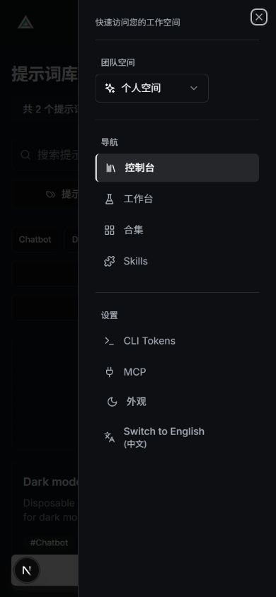

# Appearance

Use **Appearance / 外观** in the header to choose **Light / 浅色**, **Dark / 深色**, or **System / 跟随系统**. The control is also available in the mobile navigation and on the sign-in/sign-up pages.

System is the default and follows live OS appearance changes. A manual choice is stored under `promptminder-theme` and synchronized across tabs. Invalid saved values fall back to System; switching still works in memory when browser storage is unavailable.

The theme applies to the landing page, prompt forms and version comparisons, tags, teams, workspace skills, public catalogs and galleries, Playground, CLI/MCP settings and documentation, feedback, legal pages, and shared administration components. Clerk authentication/profile controls, React Select tags, Markdown, and syntax highlighting follow the selected appearance. Theme changes preserve open forms and the signed-in session.

The existing light styles, fonts, page structure, and prompt/team authorization remain in place. Theme colors use the existing CSS variables; Tailwind semantic colors support opacity modifiers. The browser `theme-color` tag is created by the pre-paint bootstrap and updated by the theme provider, avoiding duplicate React metadata tags during hydration.

## Screenshots

Light landing page:

Dark landing page:

Mobile appearance menu:

## Verification

`__tests__/components/Theme.test.jsx` covers live system changes, persistence, cross-tab synchronization, invalid preferences, unavailable storage, translated keyboard controls, and pre-paint browser theme colors.

Manual acceptance uses an independent Clerk development application and Neon development database. Check:

1. Both appearances on public pages and authenticated workspaces, including menus, dialogs, dropdowns, and empty/error states.
2. Create and edit a prompt, compare versions, edit tags, and delete a disposable prompt. Switch appearance in another tab while a form is open and confirm its values remain intact.
3. Open the Clerk user menu and profile dialog in both appearances without losing the session.
4. Check desktop and 390-pixel mobile layouts, keyboard selection, refresh persistence, and a single synchronized browser `theme-color` tag after hydration and navigation.

No database migration, authentication policy, API behavior, or additional service configuration is required for the theme feature. AI inference and file-storage integrations require their existing optional credentials and are separate from appearance verification.
